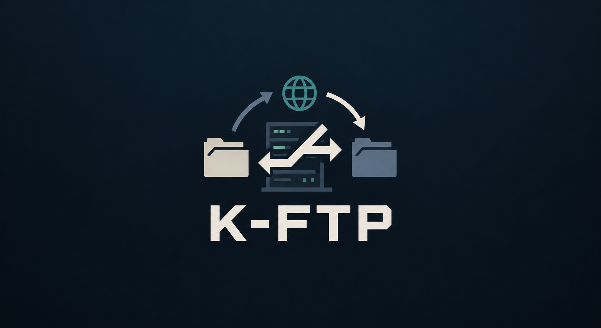

# K-FTP

A simple desktop FTP client with a graphical interface built on **PyQt6**, with asynchronous networking via **aioftp** + **qasync**. The local file system is on the left, the remote server tree is on the right, and an operation log console sits below. Connections can be saved as profiles (SQLite).

> This is a work-in-progress/learning project: some parts of the interface (the transfer queue, settings) are still placeholders. See [Status and limitations](#status-and-limitations).

## Features

- Connect to an FTP server by host, port, username and password (defaults: port `21`, user `anonymous`, socket timeout 5 seconds).
- Two-pane interface: a local tree (`QFileSystemModel`) and a remote tree with *Name / Size / Type* columns.
- Lazy loading of remote folders: a directory's contents are requested only when it is expanded; folders are listed before files, sorted by name (case-insensitive).
- Human-readable file sizes (B / KB / MB / GB / TB) and file type by MIME.
- Context menus:
  - local pane: **Send to remote server** (upload), **Delete**;
  - remote pane: **Download to local** (download into a chosen folder), **Delete from remote**.
- Confirmation prompt before any deletion.
- Connection profiles: save, pick from a drop-down list, delete (**App → Save Profile / Delete Profile**). The `Default` profile cannot be deleted.
- Timestamped operation log in the bottom console.
- Non-blocking UI: all network operations run asynchronously in the Qt event loop.

## Requirements

- Python 3.10+ (developed on Python 3.14)
- Dependencies from `requirements.txt`:

| Package | Version |
|---------|---------|
| aioftp | 0.28.3 |
| PyQt6 | 6.11.0 |
| PyQt6-Qt6 | 6.11.2 |
| PyQt6_sip | 13.13.0 |
| qasync | 0.28.0 |

> `requirements.txt` is saved in UTF-16 encoding. `pip` reads it fine, but some tools may display garbled text. Re-save it as UTF-8 if needed.

## Installation and running

```bash
git clone https://github.com/XZFlip12/k-ftp.git
cd k-ftp

python -m venv .venv
source .venv/bin/activate        # Windows: .venv\Scripts\activate

pip install -r requirements.txt
python main.py
```

## Usage

1. Enter **Host**, **Port**, **Username** and **Password** (or choose a saved profile from the drop-down list) and click **Connect**.
2. After a successful login, the server's root directory appears in the right pane. Folders expand on click, and their contents are loaded on demand.
3. Right-click an item to open the context menu for uploading, downloading and deleting.
4. To save the current connection settings, choose **App → Save Profile**; to delete the selected profile, choose **App → Delete Profile**.

### Local test server

To try the client without an external FTP server, the repository includes `test_server.py`:

```bash
python test_server.py
```

The server starts on `localhost:2121` (by default aioftp accepts anonymous users and serves the current directory). In the client, use host `localhost`, port `2121`, username `anonymous` and an empty password.

## Project structure

```
k-ftp/
├── main.py                  # Entry point, FTPClient main window, qasync loop startup
├── config.py                # Constants: defaults, log messages, SQL queries
├── handle_connection.py     # Connecting, logging in and loading the root directory
├── trees.py                 # Local/remote tree models, lazy folder loading
├── trees_interactions.py    # Context menus, upload/download/delete of files
├── profile_interactions.py  # Profile logic in the UI (load, select, save, delete)
├── db.py                    # SQLite access (profiles.db)
├── signals_and_buttons.py   # Wiring Qt signals to handlers
├── log.py                   # Timestamped messages in the log console
├── misc/format_size.py      # File size formatting
├── user_interface/
│   ├── ClientUI.ui          # Interface layout (Qt Designer)
│   └── ui_client.py         # Python code generated from the .ui file (pyuic6)
├── test_server.py           # Local aioftp FTP server for debugging
├── profiles.db              # SQLite profile database
├── requirements.txt         # Dependencies
└── .pylintrc                # pylint settings
```

### How it works

- `main.py` builds the `FTPClient` class, which inherits from `QMainWindow` and the generated `Ui_KFTP`. The logic is split into modules as plain functions that are attached to the class as methods.
- The Qt event loop is merged with `asyncio` through `qasync.QEventLoop`; async handlers are marked with `@asyncSlot`.
- Profiles are stored in the `profiles` table (`id`, `host`, `username`, `password`, `port`) in `profiles.db` next to the code. On first access a default profile (`localhost`, `default_user`) is created.
- The interface layout is edited in Qt Designer (`ClientUI.ui`); after changing it, regenerate the Python code:

  ```bash
  pyuic6 user_interface/ClientUI.ui -o user_interface/ui_client.py
  ```

## Status and limitations

- The **Settings** and **Credits** menu items are not implemented yet.
- Only plain FTP is supported: **FTPS/SFTP are not implemented**, and data (including the password) is sent unencrypted.
- Profile passwords are stored in `profiles.db` **in plain text**. Do not save sensitive credentials there.
- There are no automated tests: `test_server.py` is a helper server, not a test suite.

## Development

- Code style is checked with `pylint` (configuration in `.pylintrc`).
- `.vscode/settings.json` enables running tests via `pytest`.
- The repository currently contains `__pycache__` directories and `profiles.db`; it is recommended to add a `.gitignore` and remove them from the index.

## License

No license is specified in the repository. If you plan to share the project, add a `LICENSE` file.
